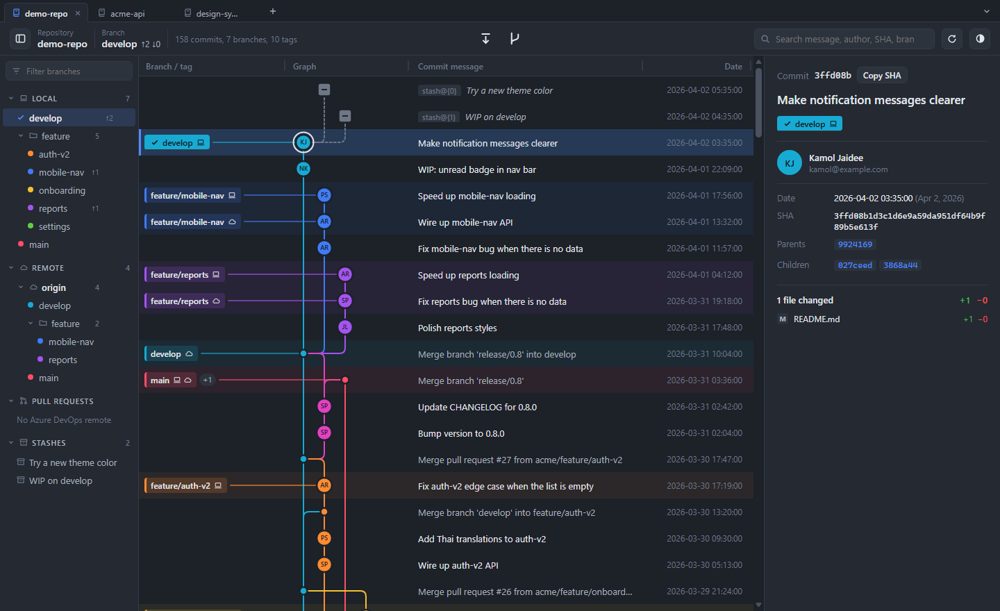
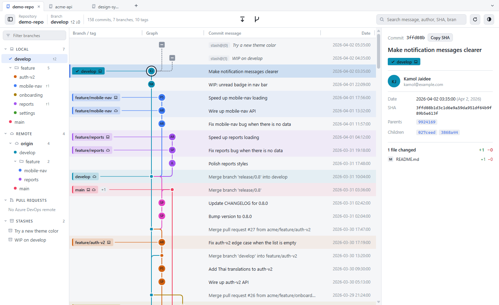

# GitKrapao

A GitKraken-style Git history viewer for the desktop. It reads repositories on your machine directly. Its focus is a commit, branch and merge graph that is easy to read and stays smooth even with hundreds of thousands of commits.

> GitKrapao changes your repository only when you ask it to **Fetch**, **Switch branch**, **Create**, **Rename** or **Delete a branch**, or **Create** or **Delete a tag**. It never commits, merges your work or rebases. It pushes only when you confirm deleting a tag on origin. Use your editor or a terminal for the rest, as usual.

Built with Tauri 2 (Rust) and TypeScript (strict) with plain HTML/CSS and no framework; esbuild bundles the UI into one file.

<p>
  
  
</p>

## Features

- **History graph:** each branch gets its own lane and color, merges are drawn, and branches and tags are labeled. Pages load on demand and only the visible part is drawn, so large repositories stay smooth.
- **Auto-refresh:** checks every 3 seconds. After a commit, fetch, checkout or rebase, only what changed is loaded.
- **Repository tabs:** open several repositories as tabs, switch with `Ctrl Tab` or `Ctrl 1`–`9`, open one with `Ctrl T` and close with `Ctrl W`. Open tabs are restored on the next start. Only the active tab is loaded and refreshed. A fetch, switch, create, rename or delete in one tab leaves the other tabs free, up to 3 at a time.
- **Left panel:**
  - every branch, split into LOCAL and REMOTE, grouped into folders by name, with ahead/behind counts
  - STASHES
  - PULL REQUESTS from Azure DevOps
- **Fetch:** the button in the middle of the toolbar or `Ctrl Shift F` runs `git fetch --all --prune`, set up so it never deletes or overwrites a local branch or tag. It runs only when you ask; there is no background fetch. Ahead/behind counts for the current branch show next to its name.
- **Switch branch:** double-click a branch in the left panel or a label in the graph, or right-click it and choose **Switch to**.
  - A remote branch with no local copy gets a local branch that tracks it.
  - A local branch that is only behind its remote is fast-forwarded. One with its own commits is left as it is.
  - Uncommitted changes are never lost. If switching would overwrite them, the app asks whether to stash them first, untracked files included.
- **Create branch or tag:** right-click a commit (or a label on it) and choose **Create branch** or **Create tag**. The branch button next to Fetch, in the middle of the toolbar, creates a branch at the selected commit, or at HEAD when none is selected.
  - The name is checked as you type: one that is taken (in any letter case), that git would refuse, or that Windows cannot store as a file cannot be used. An existing branch or tag is never overwritten.
  - A new branch is switched to right away unless you untick **Switch to the new branch**; the switch works as above.
  - A tag with a message is an annotated tag, one without is lightweight. Tags are not signed.
  - Nothing is pushed: push the new branch or tag from your editor or a terminal.
- **Rename branch:** right-click a local branch in the left panel or a label in the graph and choose **Rename branch**. The name is checked as you type, as for a new branch. Its upstream and history follow, and the checked-out branch can be renamed too. A new name that differs only in letter case is refused, because Windows stores both as one file. Branches you hid or soloed keep their setting under the new name in every tab of that repository you have opened in this session; a tab restored at startup but not opened yet, and a linked worktree that is not open as a tab, keep the old name.
- **Delete branch or tag:** right-click a local branch (the checked-out one, here or in another worktree, cannot be deleted) or a tag label and choose **Delete branch** or **Delete tag**. Every delete asks in a native dialog that names the repository.
  - **Unmerged warning:** before it asks, the app counts the commits that no other branch, remote-tracking branch, tag, stash or HEAD reaches. If there are any, the dialog says how many will no longer be on any branch.
  - After deleting a tag, if the repository has a remote called `origin`, the app asks whether to delete the tag there too and shows the URL. Nothing is pushed unless you say yes. If origin is a folder rather than a server, the question warns that pushing there runs that repository's own hooks.
  - A branch or tag that has a twin differing only in letter case (`feat` and `FEAT`) is refused, because Windows stores both as one file and git would act on both. The same goes for renaming or deleting a branch that HEAD names in another letter case.
  - Only local branches and tags are handled. Renaming or deleting a branch on a remote, and renaming a tag, are not supported yet.
- **Undo bar:** after a delete, a bar under the toolbar offers **Undo**. It puts the branch back at its commit with its upstream setting, or the tag back with its message. It works on this machine only: a tag already deleted on origin stays deleted there, and Undo stops working once git has cleaned up (`git gc --prune`). The bar goes away when you dismiss it, start another operation or switch tab.
- **Trust check:** a repository's own config or hooks can make git run programs. Before a fetch, switch, create, rename, delete or undo, the app lists any it finds and asks once; it asks again only when they change.
- **Output:** a drawer at the bottom with every fetch, switch, create, rename, delete and undo: the git commands, how long they took and what git printed.
- **Hide branches and Solo:** hide branches you don't care about, or show only a few. The choice is remembered per repository.
- **WIP row:** uncommitted files, staged and unstaged, at the top of the graph.
- **Stashes in the graph:** gray nodes above the commit each stash was made on.
- **Commit details:** full message, author, parents and children, and changed files with +/− counts.
- **Diff view:** unified or split, changes only or the full file, changed words highlighted, and syntax colors for about 20 languages.
- **Search:** by message, author, SHA or branch name.
- **Other:** light and dark themes, resizable columns, and correct Thai text rendering.

## Installing

1. Install **Git for Windows** so the `git` command works. Running `git --version` in a terminal should print a version.
2. Download `GitKrapao_x.y.z_x64-setup.exe` from the [latest release](https://github.com/korrawichT/GitKrapao/releases/latest), run it and click through to the end. It installs for the current user only, so it needs no admin rights; a newer installer updates the app in place and keeps your settings.
   - If Windows shows "Windows protected your PC", click **More info → Run anyway**. The installer is not code-signed yet.
3. Start the app, click **Open repository** (or the repository name at the top left, then **Open another repository…**) and pick any folder inside a repository.

To see Azure DevOps pull requests, install the [Azure CLI](https://learn.microsoft.com/cli/azure/install-azure-cli) and run `az login` once. Everything else works without it.

## Keyboard shortcuts

| Action | Keys |
|---|---|
| Open a repository | `Ctrl O` |
| New tab / close tab | `Ctrl T` / `Ctrl W` |
| Next / previous tab | `Ctrl Tab` / `Ctrl Shift Tab` |
| Go to tab 1–8 / the last tab | `Ctrl 1`–`8` / `Ctrl 9` |
| Full reload | `Ctrl R` or `F5` |
| Fetch | `Ctrl Shift F` |
| Show/hide the left panel | `Ctrl B` |
| Move between commits | `↑` `↓` or `J` `K`, `Home` / `End` |
| Search | `/`, then type; `Enter` jumps to the next match |
| In the left panel | Arrow keys to move and open folders, `Enter` to go to a branch, `H` to hide, `S` to solo |
| In the diff view | `J` / `K` (or `]` / `[`) for the next/previous file |
| Close the diff, details, or the create or rename dialog | `Esc` |

On macOS use `⌘` instead of `Ctrl`, except for `Ctrl Tab` / `Ctrl Shift Tab`, which stay `Ctrl`.

## Privacy

- The app works only through the machine's own `git` command. There is no server, no telemetry, and your code is never sent anywhere.
- It connects outside your machine in three cases:
  - **Fetch**, only when you press it. It contacts the repository's remotes with your own git credentials and SSH setup.
  - **Deleting a tag on origin**, only after you confirm it in a dialog that shows the URL. It runs `git push --delete` with your own git credentials and SSH setup, never signed.
  - **Pull requests**, fetched with `az` using the account you signed in with.
- The app stores no tokens or passwords.
- Viewing history and diffs always runs with `--no-ext-diff --no-textconv`, so a repository's config cannot make it run other programs.
- Fetch, switch, create, rename, delete and undo run whatever git normally runs, such as hooks and filters. When those come from the repository itself, the trust check asks you first. Your answers are kept as SHA-256 hashes in `trust.json` in the app's data folder.

## Development

### Requirements (Windows)

- Git, Node.js 18+ and [pnpm](https://pnpm.io/installation)
- Rust via [rustup](https://rustup.rs)
- Visual Studio Build Tools with the **"Desktop development with C++"** workload and a Windows SDK

Only tested on Windows 11. Tauri also supports macOS and Linux, but this app has not been built on them yet.

### Commands

```bash
pnpm install
pnpm run dev       # run the app in development mode (the first Rust compile takes several minutes)
pnpm run build     # build the installers
pnpm run mock      # build a sample repository for testing at .mock/demo-repo
pnpm run screenshots # redo docs/screenshots from that repository in headless Edge
pnpm run web:build # bundle the UI into dist/ (Tauri does this itself in dev and build)
pnpm run typecheck # TypeScript, strict (esbuild does not check types)
pnpm run test:ui   # UI tests in headless Microsoft Edge, including a layout snapshot
pnpm run check:bindings            # Rust structs and src/bindings still match
cd src-tauri && cargo test --lib   # Rust unit tests (also regenerates src/bindings)
```

`pnpm run build` writes to `src-tauri/target/release/bundle/`:

- `nsis/GitKrapao_<version>_x64-setup.exe`: the installer to share
- `msi/GitKrapao_<version>_x64_en-US.msi`: an MSI installer

Don't share the whole `target` folder; it holds several GB of build files.

`pnpm run mock` builds a fake repository, identical on every run, with:
- 158 commits, branches, tags and a remote
- 2 stashes
- English commit messages

Test against it instead of real work repositories.

After `pnpm run web:build`, opening `dist/index.html` in a browser starts a mode where you paste `git log` output yourself, with built-in sample data. No Rust is needed for that.

### Layout

```
src/                    UI source; scripts/web.mjs bundles it into dist/
  index.html
  app.ts                graph, left panel, details, diff view, auto-refresh
  highlight.ts          syntax colors for the diff view
  ipc.ts                typed calls into the Rust commands
  refname.ts            branch and tag name rules for the create and rename dialogs
  types.ts              the UI's own types (commits, edges, layout, state)
  bindings/             types of the data Rust sends, generated by ts-rs
  app.css
src-tauri/
  src/lib.rs            Rust commands that run git and hand data to the UI
  src/fetch.rs          fetch, the trust check and the time limit for git
  src/switch.rs         switch branch, fast-forward and stash
  src/create.rs         create a branch or tag at a commit
  src/refedit.rs        rename a branch, delete a branch or tag, and Undo
  tests/fixtures/       real git output used by the unit tests
  tauri.conf.json       app name, window, CSP, bundling
scripts/
  tauri.mjs             runs the Tauri CLI with ~/.cargo/bin added to PATH
  web.mjs               bundles the UI with esbuild (also --watch, --test)
  check-bindings.mjs    fails when src/bindings no longer matches the Rust structs
  mock-repo.mjs         builds the sample repository
  screenshots.mjs       makes the README screenshots from it
tests/ui/               headless Edge UI suites and the layout snapshot
CLAUDE.md               design rules and decisions (read before changing code)
GLOSSARY.md             what the app means by branch, remote-tracking branch, unreachable commits, Undo
```

The project used to be called `lanes`. Two internal names keep that name on purpose:
- the `lanes.*` localStorage keys
- the `local.lanes.gitgraph` identifier

Never rename the keys or the identifier, or users lose their saved settings.

## Troubleshooting

| Problem | Fix |
|---|---|
| `detected dubious ownership` | The repository is on a network drive or has a different owner. Run `git config --global --add safe.directory <path>` as git suggests. |
| `Git was not found` | Install Git, then restart the app. |
| `cargo metadata ... program not found` during `pnpm run dev` | The VS Code terminal still has the PATH from before Rust was installed. Close every VS Code window and reopen it. `scripts/tauri.mjs` already handles the usual case. |
| `link: extra operand` | MSVC's `link.exe` was not found, so Git's `link` ran instead. Install the "Desktop development with C++" workload. |
| PRs say "Sign in first" | Run `az login` in a terminal, then press Refresh. |
| Fetch says "Authentication failed" or times out | The app never shows git's password prompt. For HTTPS, run `git fetch` once in a terminal so Git Credential Manager saves your sign-in. For SSH, start ssh-agent and add your key with `ssh-add`. Then fetch again. |
| Switch (or Create branch with **Switch to the new branch**) asks to stash | Switching would overwrite uncommitted changes. Choose **Stash and switch** to keep them in a stash (shown under STASHES), or **Cancel** and commit them first. |

## Contributing

Bug reports, ideas and pull requests are welcome: see [CONTRIBUTING.md](.github/CONTRIBUTING.md) and the [Code of Conduct](.github/CODE_OF_CONDUCT.md). Report security problems privately, as described in [SECURITY.md](.github/SECURITY.md).
