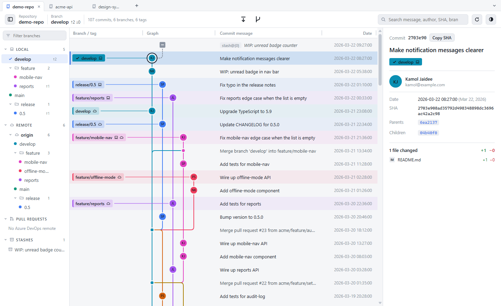

# GitKrapao

A desktop Git client built around a clear commit graph. Every branch gets its own lane, merges are drawn, and large repositories stay smooth.

> It changes a repository only when you ask: **Fetch**, **Switch branch**, **Create**, **Rename** or **Delete** a branch, **Create** or **Delete** a tag. It never commits, merges or rebases for you. It pushes only when you confirm deleting a tag on origin.

<picture>
  <source media="(prefers-color-scheme: dark)" srcset="docs/screenshots/graph-dark.png">
  <source media="(prefers-color-scheme: light)" srcset="docs/screenshots/graph-light.png">
  
</picture>

## Features

- **History graph:** a lane and color per branch, labeled branches and tags, loaded on demand.
- **Auto-refresh:** picks up commits, fetches and checkouts within seconds, loading only what changed.
- **Tabs:** one repository per tab, restored on the next start. Only the active tab is loaded.
- **Left panel:** local and remote branches with ahead/behind, stashes, and Azure DevOps pull requests.
- **Fetch:** `git fetch --all --prune`, only when you press it. It never deletes or overwrites a local branch or tag.
- **Switch branch:** double-click a branch. Uncommitted changes are never lost; the app offers to stash them first.
- **Create branch or tag:** right-click a commit. Names are checked as you type, and nothing is pushed.
- **Rename and delete branch, delete tag:** local only. Deleting warns how many commits would be left on no branch. Two names that differ only in letter case are refused, because Windows stores them as one file.
- **Undo:** brings a deleted branch or tag back on this machine only. It stops working after `git gc --prune`, and a tag already deleted on origin stays deleted there.
- **Trust check:** asks before git runs anything a repository's own config or hooks set up.
- **Output:** a drawer with every git command the app ran and what git printed.
- **Hide and Solo:** hide branches you don't need, or show only a few.
- **WIP row and stash nodes:** uncommitted changes and stashes sit in the graph.
- **Commit details and diff view:** unified or split, changed words highlighted, syntax colors for about 20 languages.
- **Search:** by message, author, SHA or branch.
- **Other:** light and dark themes, resizable columns, Thai text.

## Installing

1. Install **Git for Windows**. `git --version` should print a version.
2. Download `GitKrapao_x.y.z_x64-setup.exe` from the [latest release](https://github.com/korrawichT/GitKrapao/releases/latest) and run it. It installs for the current user, needs no admin rights, and updates in place.
   - If Windows says "Windows protected your PC", click **More info → Run anyway**. The installer is not code-signed yet.
3. Start the app and open any folder inside a repository.

For pull requests, install the [Azure CLI](https://learn.microsoft.com/cli/azure/install-azure-cli) and run `az login` once. Everything else works without it.

## Keyboard shortcuts

| Action | Keys |
|---|---|
| Open a repository | `Ctrl O` |
| New tab / close tab | `Ctrl T` / `Ctrl W` |
| Next / previous tab | `Ctrl Tab` / `Ctrl Shift Tab` |
| Go to tab 1–8 / the last tab | `Ctrl 1`–`8` / `Ctrl 9` |
| Full reload | `Ctrl R` or `F5` |
| Fetch | `Ctrl Shift F` |
| Show/hide the left panel | `Ctrl B` |
| Move between commits | `↑` `↓` or `J` `K`, `Home` / `End` |
| Search | `/`, then type; `Enter` jumps to the next match |
| In the left panel | Arrow keys to move, `Enter` to go to a branch, `H` to hide, `S` to solo |
| In the diff view | `J` / `K` (or `]` / `[`) for the next/previous file |
| Close the diff, details or a dialog | `Esc` |

On macOS use `⌘` instead of `Ctrl`, except for `Ctrl Tab` / `Ctrl Shift Tab`.

## Privacy

- The app only runs your own `git` command. There is no server and no telemetry; your code never leaves your machine.
- It goes online in three cases:
  - **Fetch**, only when you press it, with your own git credentials.
  - **Deleting a tag on origin**, only after you confirm a dialog that shows the URL.
  - **Pull requests**, through `az` and the account you signed in with.
- It stores no tokens or passwords.
- Viewing history and diffs runs with `--no-ext-diff --no-textconv`, so a repository's config cannot start other programs.
- Operations that change a repository run whatever git normally runs, such as hooks and filters. When those come from the repository itself, the trust check asks first. Your answers are kept as SHA-256 hashes in `trust.json` in the app's data folder.

## Development

### Requirements (Windows)

- Git, Node.js 18+ and [pnpm](https://pnpm.io/installation)
- Rust via [rustup](https://rustup.rs)
- Visual Studio Build Tools with the **"Desktop development with C++"** workload and a Windows SDK

Built with Tauri 2 (Rust) and strict TypeScript, with plain HTML/CSS. Only tested on Windows 11; Tauri also supports macOS and Linux, but this app has not been built on them yet.

### Commands

```bash
pnpm install
pnpm run dev       # run the app in development mode (the first Rust compile takes several minutes)
pnpm run build     # build the installers
pnpm run mock      # build a sample repository at .mock/demo-repo
pnpm run screenshots # redo docs/screenshots from that repository in headless Edge
pnpm run web:build # bundle the UI into dist/ (Tauri does this itself in dev and build)
pnpm run typecheck # TypeScript, strict (esbuild does not check types)
pnpm run test:ui   # UI tests in headless Microsoft Edge, including a layout snapshot
pnpm run check:bindings            # Rust structs and src/bindings still match
cd src-tauri && cargo test --lib   # Rust unit tests (also regenerates src/bindings)
```

`pnpm run build` writes to `src-tauri/target/release/bundle/`: `nsis/GitKrapao_<version>_x64-setup.exe` (the installer to share) and `msi/GitKrapao_<version>_x64_en-US.msi`. Don't share the whole `target` folder; it holds several GB.

Test against `pnpm run mock`, never real work repositories. It builds the same fake repository every run: about 100 commits, many merged branches, tags, a remote and 1 stash.

After `pnpm run web:build`, opening `dist/index.html` in a browser starts a mode with built-in sample data where you can paste `git log` output. No Rust is needed.

### Layout

```
src/                    UI source; scripts/web.mjs bundles it into dist/
  index.html
  app.ts                graph, left panel, details, diff view, auto-refresh
  highlight.ts          syntax colors for the diff view
  ipc.ts                typed calls into the Rust commands
  refname.ts            branch and tag name rules for the create and rename dialogs
  types.ts              the UI's own types (commits, edges, layout, state)
  bindings/             types of the data Rust sends, generated by ts-rs
  app.css
src-tauri/
  src/lib.rs            Rust commands that run git and hand data to the UI
  src/fetch.rs          fetch, the trust check and the time limit for git
  src/switch.rs         switch branch, fast-forward and stash
  src/create.rs         create a branch or tag at a commit
  src/refedit.rs        rename a branch, delete a branch or tag, and Undo
  tests/fixtures/       real git output used by the unit tests
  tauri.conf.json       app name, window, CSP, bundling
scripts/
  tauri.mjs             runs the Tauri CLI with ~/.cargo/bin added to PATH
  web.mjs               bundles the UI with esbuild (also --watch, --test)
  check-bindings.mjs    fails when src/bindings no longer matches the Rust structs
  mock-repo.mjs         builds the sample repository
  screenshots.mjs       makes the README screenshots from it
tests/ui/               headless Edge UI suites and the layout snapshot
CLAUDE.md               design rules and decisions (read before changing code)
GLOSSARY.md             what the app means by branch, remote-tracking branch, unreachable commits, Undo
```

The project used to be called `lanes`. Two internal names keep it on purpose: the `lanes.*` localStorage keys and the `local.lanes.gitgraph` identifier. Never rename them, or users lose their saved settings.

## Troubleshooting

| Problem | Fix |
|---|---|
| `detected dubious ownership` | The repository is on a network drive or has another owner. Run `git config --global --add safe.directory <path>` as git suggests. |
| `Git was not found` | Install Git, then restart the app. |
| `cargo metadata ... program not found` during `pnpm run dev` | The VS Code terminal has the PATH from before Rust was installed. Close every VS Code window and reopen it. |
| `link: extra operand` | MSVC's `link.exe` was not found, so Git's `link` ran. Install the "Desktop development with C++" workload. |
| PRs say "Sign in first" | Run `az login` in a terminal, then press Refresh. |
| Fetch says "Authentication failed" or times out | The app never shows git's password prompt. For HTTPS, run `git fetch` once in a terminal so Git Credential Manager saves your sign-in. For SSH, start ssh-agent and `ssh-add` your key. |
| Switch asks to stash | Switching would overwrite uncommitted changes. Choose **Stash and switch**, or **Cancel** and commit them first. |

## Contributing

Bug reports, ideas and pull requests are welcome: see [CONTRIBUTING.md](.github/CONTRIBUTING.md) and the [Code of Conduct](.github/CODE_OF_CONDUCT.md). Report security problems privately, as described in [SECURITY.md](.github/SECURITY.md).

## License

[MIT](LICENSE). Contributions are accepted under the same license.
